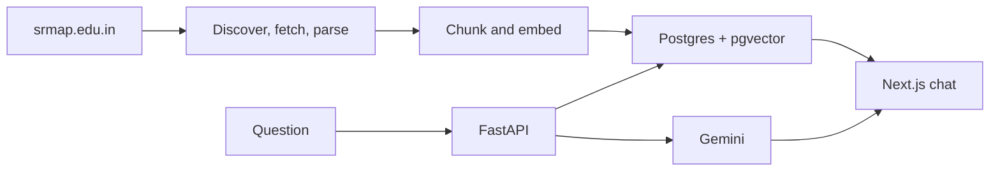

# SRM University-AP Campus Assistant

A standalone chat app that answers questions about [SRM University-AP](https://www.srmap.edu.in/) from the university’s own pages. Answers are retrieved from an indexed copy of the site, written with citations, and streamed into the chat UI.

**Live demo:** [srm-rag-based-ai-chatbot.vercel.app](https://srm-rag-based-ai-chatbot.vercel.app/)

Ask about admissions, tuition, scholarships, programmes, faculty, hostels, or placements. Numbered citations open the official source.

## What it does

- Crawls public pages and priority PDFs from srmap.edu.in
- Embeds the text locally and stores it in Postgres with pgvector
- Retrieves with vector search, full-text search, and reciprocal rank fusion
- Streams a grounded answer from Gemini, with inline citations
- Skips retrieval for greetings, and dates fee and admission answers when the source has a modified date

The public index currently holds **3,635 documents** and **21,466 chunks**, embedded with `BAAI/bge-small-en-v1.5` (384 dimensions).

## Architecture



1. **Discover** URLs from the WordPress REST API and Yoast sitemaps.
2. **Fetch and parse** HTML and priority PDFs. Crawl and embedding are separate, so a recrawl does not delete document text.
3. **Embed** chunks with local BGE-small on CPU. Gemini embeddings (768-d) are an alternate index and are never mixed with BGE.
4. **Retrieve** with pgvector, Postgres full-text search, and reciprocal rank fusion.
5. **Answer** with Gemini over server-sent events. Citation chips open the real source URL.

## Stack

| Layer | Choice |
| --- | --- |
| Frontend | Next.js, Tailwind, react-markdown |
| API | FastAPI, server-sent events |
| Chat model | Gemini |
| Embeddings | BAAI/bge-small-en-v1.5 on CPU |
| Database | Postgres 16 + pgvector |
| Production | Vercel, Cloud Run, Supabase |

## Corpus

Indexed: pages, programmes, faculty, staff, leadership, news, press releases, placements, and priority PDFs such as admission and scholarship booklets.

Not indexed: the publications archive, patents, projects, and taxonomy archives. Some programme pages are thin Elementor shells, and a few PDFs are image-only.

## Run locally

### 1. Configure

```bash
cp .env.example .env
```

Set `GEMINI_CHAT_API_KEY` from [Google AI Studio](https://aistudio.google.com/apikey). The production index uses local BGE:

```env
EMBEDDING_PROVIDER=local
EMBEDDING_DIMS=384
TRUSTED_PROXY_HOPS=0
```

`TRUSTED_PROXY_HOPS=0` ignores `X-Forwarded-For` on your machine. Cloud Run sets it to `1`.

### 2. Start Postgres

```bash
docker compose up -d
```

### 3. Install Python

```bash
python -m venv .venv
```

Windows:

```powershell
.venv\Scripts\activate
$env:PYTHONPATH = (Get-Location).Path
```

macOS or Linux:

```bash
source .venv/bin/activate
export PYTHONPATH=$PWD
```

```bash
pip install -r ingestion/requirements.txt -r backend/requirements.txt
pip install pytest
```

### 4. Build the index

```bash
python -m ingestion.cli discover
python -m ingestion.cli fetch
python -m ingestion.cli parse
python -m ingestion.cli pdfs
python -m ingestion.cli persist
python -m ingestion.cli prepare-local-index
python -m ingestion.cli embed-worker --batch-size 16 --max-per-run 10000
python -m ingestion.cli status
```

`fetch --limit` and `parse --limit` are useful for a small trial before a full crawl. `persist` writes documents and chunks only. It does not call an embedding API. `load` is an alias of `persist`.

Switching embedding models requires a cutover:

```bash
python -m ingestion.cli prepare-local-index    # 384-d BGE
python -m ingestion.cli prepare-gemini-index   # 768-d Gemini
```

Those commands clear incompatible vectors and requeue chunks. They do not delete document text.

### 5. Run the app

```bash
cd backend
uvicorn app.main:app --reload --port 8000
```

```bash
cd frontend
npm install
npm run dev
```

Open [http://localhost:3000](http://localhost:3000). The UI reads `NEXT_PUBLIC_API_URL` (default `http://localhost:8000`).

### 6. Test

From the repo root, with `PYTHONPATH=backend`:

```bash
pytest backend/tests
```

`python eval/run_eval.py` checks retrieval against the golden questions. It needs a loaded database. `--generate` also scores citations and grounded amounts with the same chat model. It does not add a second judge model. Greeting and empty-retrieval cases run without the database.

## Project layout

```
ingestion/     discover, fetch, parse, chunk, embed
backend/       FastAPI retrieval and streaming chat
frontend/      Next.js chat UI
eval/          golden questions and deterministic checks
data/          HTML cache, parsed JSON, PDFs (gitignored)
```

## Deploy

| Piece | Host | Guide |
| --- | --- | --- |
| Chat UI | Vercel | [DEPLOY.md](./DEPLOY.md) |
| API and local embedder | Cloud Run | [DEPLOY_CLOUD_RUN.md](./DEPLOY_CLOUD_RUN.md) |
| Postgres and pgvector | Supabase | [DEPLOY_SUPABASE.md](./DEPLOY_SUPABASE.md) |

The API image can also run as a Hugging Face Docker Space. That is not the current production host. See [DEPLOY_HF.md](./DEPLOY_HF.md).

Cloud Run is deployed with concurrency 4, at most 2 instances, and a 120 second timeout. Those are initial safety settings, not a billing cap. Chat logs omit the raw question. `/health/live` does not query the database. `/health/ready` checks that the database accepts a connection. Per-IP rate limits apply inside each instance, not across all instances.

## Limits

Answers are only as current as the last crawl. Fees, deadlines, and seat rules should be checked on srmap.edu.in. The assistant says when it cannot find a source, and it is not a substitute for the admissions office.
