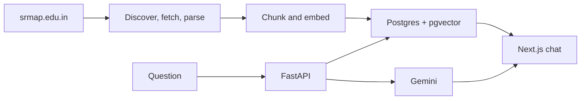

# SRM University-AP Campus Assistant

A standalone chat app that answers questions about [SRM University-AP](https://www.srmap.edu.in/) from the university’s own pages. Answers are retrieved from an indexed copy of the site, written with citations, and streamed into a ChatGPT-style interface.

**Live demo:** [srm-rag-based-ai-chatbot.vercel.app](https://srm-rag-based-ai-chatbot.vercel.app/)

Ask about admissions, tuition, scholarships, programmes, faculty, hostels, or placements. Each reply links the numbered citations back to the official source.

## What it does

- Crawls public pages and priority PDFs from srmap.edu.in
- Embeds the text locally and stores it in Postgres with pgvector
- Retrieves with a hybrid of vector search and full-text search
- Streams a grounded answer from Gemini, with inline citations
- Skips retrieval for greetings, and keeps fee and admission answers dated

The public index currently holds **3,635 documents** and **21,466 chunks**, embedded with `BAAI/bge-small-en-v1.5` (384 dimensions).

## Architecture



1. **Discover** URLs from the WordPress REST API and Yoast sitemaps.
2. **Fetch and parse** HTML and priority PDFs. Crawl and embedding are separate, so a recrawl does not wipe the index.
3. **Embed** chunks with local BGE-small on CPU. Gemini embeddings (768-d) are an alternate index, never mixed with BGE.
4. **Retrieve** with pgvector, Postgres full-text search, and reciprocal rank fusion.
5. **Answer** with Gemini, streamed over server-sent events. Citation chips open the real source URL.

## Stack

| Layer | Choice |
| --- | --- |
| Frontend | Next.js, Tailwind, react-markdown |
| API | FastAPI, SSE streaming |
| Chat model | Gemini |
| Embeddings | BAAI/bge-small-en-v1.5 on CPU |
| Database | Postgres 16 + pgvector |
| Production | Vercel · Cloud Run · Supabase |

## Corpus

Indexed: pages, programmes, faculty, staff, leadership, news, press releases, placements, and priority PDFs such as admission and scholarship booklets.

Not indexed: the publications archive, patents, projects, and taxonomy archives. Some programme pages are thin Elementor shells, and a few PDFs are image-only.

## Run locally

### 1. Configure

```bash
cp .env.example .env
```

Set `GEMINI_CHAT_API_KEY` from [Google AI Studio](https://aistudio.google.com/apikey). For the local BGE index used in production:

```env
EMBEDDING_PROVIDER=local
EMBEDDING_DIMS=384
```

### 2. Start Postgres

```bash
docker compose up -d
```

### 3. Install Python

```bash
python -m venv .venv
```

Windows:

```powershell
.venv\Scripts\activate
$env:PYTHONPATH = (Get-Location).Path
```

macOS or Linux:

```bash
source .venv/bin/activate
export PYTHONPATH=$PWD
```

```bash
pip install -r ingestion/requirements.txt -r backend/requirements.txt
```

### 4. Build the index

```bash
python -m ingestion.cli discover
python -m ingestion.cli fetch
python -m ingestion.cli parse
python -m ingestion.cli pdfs
python -m ingestion.cli persist
python -m ingestion.cli prepare-local-index
python -m ingestion.cli embed-worker --batch-size 16 --max-per-run 10000
python -m ingestion.cli status
```

`fetch --limit` and `parse --limit` are useful for a small trial before a full crawl. `persist` writes documents and chunks only. It does not call an embedding API.

Switching embedding models requires a cutover, not a mix:

```bash
python -m ingestion.cli prepare-local-index    # 384-d BGE
python -m ingestion.cli prepare-gemini-index   # 768-d Gemini
```

Those commands clear incompatible vectors and requeue chunks. They do not delete document text.

### 5. Run the app

```bash
cd backend
uvicorn app.main:app --reload --port 8000
```

```bash
cd frontend
npm install
npm run dev
```

Open [http://localhost:3000](http://localhost:3000). The UI reads `NEXT_PUBLIC_API_URL` (default `http://localhost:8000`).

## Project layout

```
ingestion/     discover, fetch, parse, chunk, embed
backend/       FastAPI retrieval and streaming chat
frontend/      Next.js chat UI
eval/          golden questions
data/          HTML cache, parsed JSON, PDFs (gitignored)
```

## Deploy

The public app is the Next.js UI on Vercel, this API on Cloud Run, and the database on Supabase. Cloud Run serves both FastAPI and the local embedding model, so query vectors stay in the same space as the index.

See [DEPLOY_CLOUD_RUN.md](./DEPLOY_CLOUD_RUN.md), [DEPLOY_SUPABASE.md](./DEPLOY_SUPABASE.md), and [DEPLOY.md](./DEPLOY.md).

## Limits

Answers are only as current as the last crawl. Fees, deadlines, and seat rules should be checked on srmap.edu.in. The assistant does not invent a source when retrieval is empty, and it is not a substitute for the admissions office.
